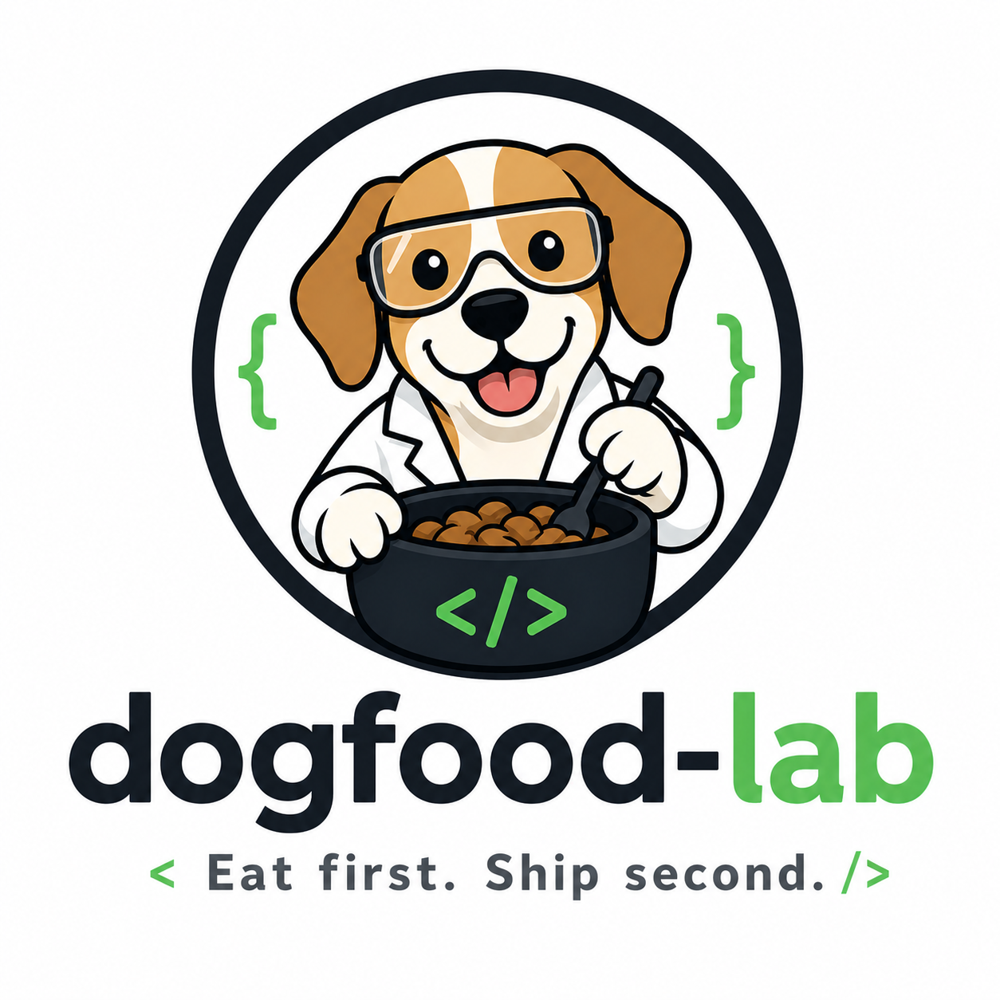

# dogfood-lab

**Methods and tools for testing AI-assisted software, used on our own work first.**

---

## What we build

As more software is written with AI help, checking it matters more, not less. Dogfood Lab builds the testing side of that work: the maps, gates and methods that tell you what a change reaches and whether a claim holds.

Everything here is used first on the [MCP Tool Shop](https://github.com/mcp-tool-shop-org) repositories, our sister organization, before anyone else is asked to try it.

---

## Projects

| Project | What it is | Install |
|:---|:---|:---|
| [testing-os](https://github.com/dogfood-lab/testing-os), home of **Atlas** | A map of each repository: its parts, the workflows that start work, and what a change reaches. Every MCP Tool Shop repository with workflows keeps an Atlas map, and CI checks it on every push. testing-os also takes a repository through health, feature and release passes with a coordinated team of agents. [Handbook](https://dogfood-lab.github.io/testing-os/) | `npx @dogfood-lab/atlas` |
| [study-swarm](https://github.com/dogfood-lab/study-swarm) | A method for grounding a design decision in cited research before it is built, with every citation checked before it becomes canon. [Handbook](https://dogfood-lab.github.io/study-swarm/) | `npx @dogfood-lab/study-swarm` |
| [interface-audits](https://github.com/dogfood-lab/interface-audits) | Proof-backed audits of human-facing product surfaces. [Handbook](https://dogfood-lab.github.io/interface-audits/) | |

---

## How we work

| | |
|---|---|
| **Our own work first** | A tool is used on our repositories before it is released to anyone else. |
| **Evidence, not self-reports** | A result comes with the run that produced it, committed beside it. |
| **Checked in CI** | A method that matters runs on every push, not only when someone remembers. |
| **Local first** | It runs on your hardware, with no cloud service required. |

## Lanes

- **Shipped**: testing tools with CI, tests, releases and an install command.
- **Active lab**: experiments in progress.
- **Seed vault**: archived prototypes kept as revival candidates.

---

## Community

Questions, ideas and bugs go in the issues of the relevant repository.

---

**[All repositories](https://github.com/orgs/dogfood-lab/repositories)**

*Eat first. Ship second.*

